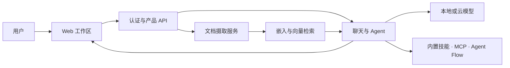

# AnythingLLM · Recipkg

**自托管 AI 工作区配方：文档检索、聊天、Agent 工具与技能治理。**

[](https://github.com/Mintplex-Labs/anything-llm)
[](https://github.com/Mintplex-Labs/anything-llm/blob/9b1fcab141000eaba9f78ed131151de04904454b/LICENSE)
[](https://github.com/recipkg/standard-library)

[标准库](https://github.com/recipkg/standard-library) · [配方清单](RECIPE.md) · [构建提示词](BUILD_PROMPT.md) · [验收条件](ACCEPTANCE.md) · [覆盖记录](COVERAGE.md) · [来源与许可](SOURCES.md)


本仓库保存 Markdown 重建配方，不是 AnythingLLM 源码或官方发行版。目标固定为上游 v1.19.0；配方仍在提取中。已观察内容、依赖固定和未验证边界见 [COVERAGE.md](COVERAGE.md)。

## 软件组成



README 将上游划分为 React 前端、Node 服务端和独立文档采集服务，并列出 MCP、可视化 Agent Flow、模型/向量适配与多用户功能。图示是产品能力关系，不表示本配方已经重建或验证了各组件。

## 固定来源

- 上游：[Mintplex-Labs/anything-llm](https://github.com/Mintplex-Labs/anything-llm/tree/9b1fcab141000eaba9f78ed131151de04904454b)
- 版本：v1.19.0，提交 9b1fcab141000eaba9f78ed131151de04904454b
- 上游根许可证：MIT；具体范围与注意事项见 [SOURCES.md](SOURCES.md)
- 2026-10-29 星数快照：67,689；星数会变化，也不证明质量或覆盖完整

## Recipkg 依赖

| 别名 | 用途 | 固定来源 |
| --- | --- | --- |
| quality | 设计、工程、错误恢复与性能证据合同 | [software-quality](https://github.com/recipkg/recipkg/tree/7f05425ae9843b7e8ce15cb80917977eedb36bdd/recipes/software-quality) |
| design | 面向任务的界面方向，递归包含设计基础合同 | [design-directions](https://github.com/recipkg/design-directions/tree/6fdba350d1effa2d50dc0185095bb91ca7a699ee) |

这些是构建指导配方，不是 AnythingLLM 的运行时依赖。真实重建仍需要自行准备模型、文档处理、向量存储和持久化环境。

## 检查配方包

```sh
out_dir="$(mktemp -d)"
recipkg pack . -o "$out_dir/anything-llm-0.1.0.recipe.tar.gz"
recipkg check "$out_dir/anything-llm-0.1.0.recipe.tar.gz"
recipkg build "$out_dir/anything-llm-0.1.0.recipe.tar.gz" --lang zh-CN --output "$out_dir/build.md"
```

打包与归档检查只验证 Recipkg 材料和递归依赖；不能替代 [ACCEPTANCE.md](ACCEPTANCE.md) 的软件重建验收。
